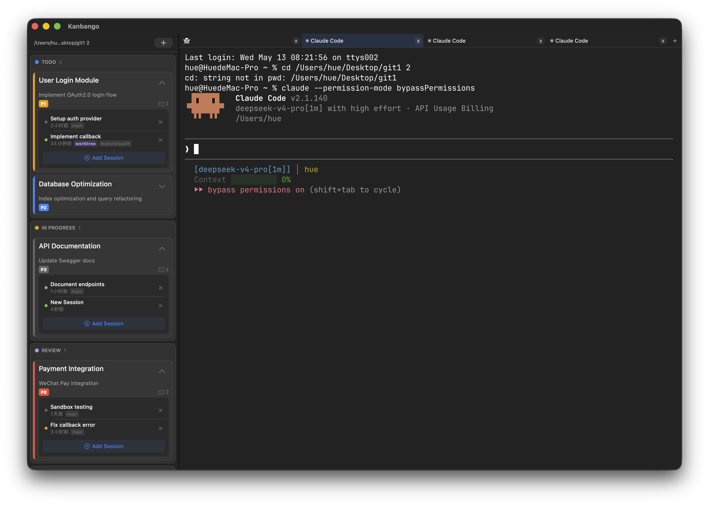
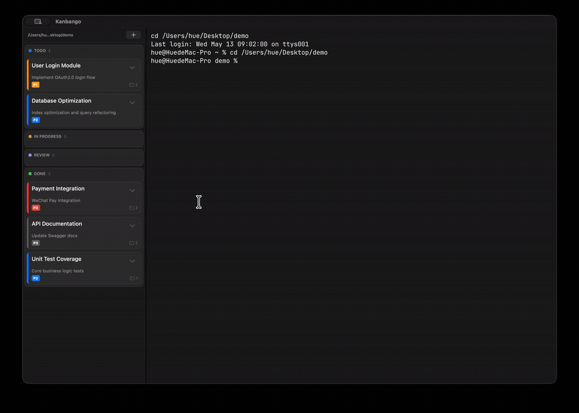
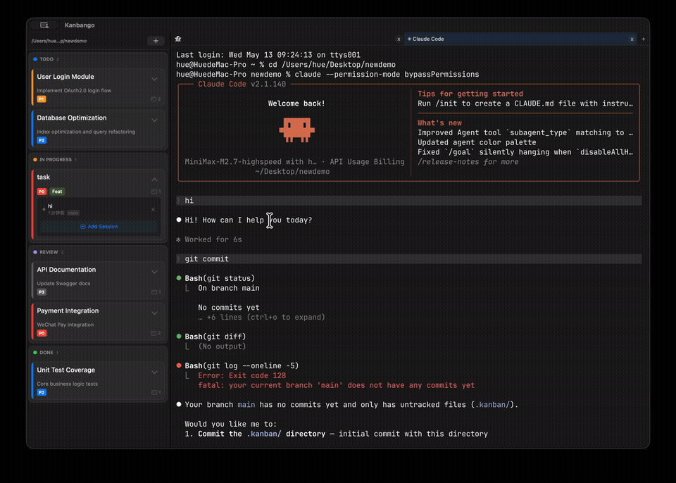

<p align="right">
  <a href="README.zh.md">中文</a>
</p>

# Kanbango

A macOS kanban board that embeds [Ghostty](https://ghostty.org) terminals for managing Claude Code sessions.

Website: [onelasthuman.github.io/Kanbango](https://onelasthuman.github.io/Kanbango/)



## Usage

### Task Management

Drag cards between columns, double-click to edit, or create new tasks with tags and priorities.



### Session Management

Each task can have multiple Claude Code sessions. Expand a card to view session status (running / idle / need input), resume worktrees, or start new sessions.



## Features

- **Kanban board** — Todo / In Progress / Review / Done columns with drag-and-drop cards
- **Embedded terminal** — Ghostty terminal rendered directly via C API in SwiftUI, no WebView
- **Claude Code integration** — Create, monitor, resume Claude Code sessions from the kanban board
- **Real-time status** — JSONL watcher tracks session state (running / idle / waiting for input)
- **Session management** — Multi-tab terminals, each linked to a kanban task
- **Dark / Light theme** — Syncs with system appearance
- **Tags & priorities** — P0-P3, bug/feat/docs/refac/test/ui/sec/perf tags
- **Workspace isolation** — Switch between projects, each with its own task data

## Requirements

- macOS 13+
- Xcode 15+ (with command line tools: `xcode-select --install`)
- Zig compiler (`brew install zig`)

## Quick Start

```bash
git clone https://github.com/OneLastHuman/Kanbango.git
cd Kanbango

# Build the Ghostty embedding library
./scripts/build-ghostty-lib.sh

# Build and run
bash run.sh
```

## Project Structure

```
Kanbango/
├── Sources/
│   ├── Kanbango/              # Kanban board app (~13 files)
│   │   ├── KanbanBoardState   # State management (singleton)
│   │   ├── SessionManager     # Session lifecycle & JSONL sync
│   │   ├── TerminalTabManager # Ghostty tab management
│   │   ├── JsonlWatcher       # Claude JSONL file monitoring
│   │   ├── KanbanView         # Board UI (columns + cards)
│   │   └── ...
│   ├── GhosttyRuntime/        # Swift runtime from Ghostty (invasive integration)
│   ├── GhosttyKit/            # C bridge module, links libghostty-internal.a
│   └── GhosttyObjC/           # ObjC bridge module
├── scripts/
│   └── build-ghostty-lib.sh   # Build libghostty-internal.a from Ghostty source
├── Package.swift              # SPM package definition
├── run.sh                     # Build → bundle .app → launch (dev)
└── release.sh                 # Build → bundle .app → install to /Applications
```

## Architecture

```
JsonlWatcher (GCD) ──onChange──► SessionManager ──► BoardState (save JSON)
                                     │
                          createSession() ──► TerminalTabManager.newTab()
                                     │
                              sendText("claude ...") ──► Ghostty terminal
```

Key components:

| Component | Role |
|-----------|------|
| `BoardState` | CRUD for tasks, theme, workspace path; auto-persists to `tasks.json` |
| `SessionManager` | Creates/resumes/deletes Claude sessions; dual-index mapping |
| `TerminalTabManager` | Ghostty surface tabs, create/switch/close |
| `JsonlWatcher` | GCD-based watcher on `~/.claude/projects/` with incremental parsing |
| `Persistence` | JSON load/save to workspace `.kanban/` or `~/Library/...` |

## License

MIT. See [LICENSE](LICENSE).

This project incorporates code derived from [Ghostty](https://github.com/ghostty-org/ghostty) (MIT).
