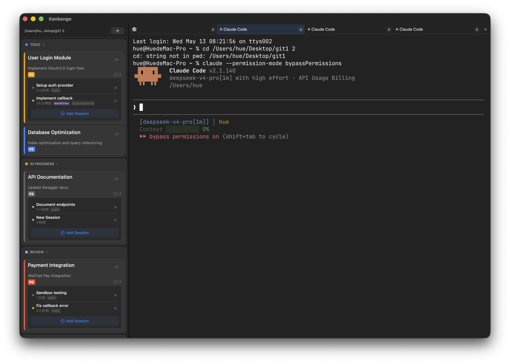

<p align="right">
  <a href="README.md">English</a>
</p>

# Kanbango

一个 macOS 看板应用，将 [Ghostty](https://ghostty.org) 终端通过 C API 嵌入 SwiftUI，用于管理 Claude Code 会话。



## 使用方法

### 任务管理

在列间拖拽卡片排序，双击编辑，或创建带标签和优先级的新任务。

[](https://raw.githubusercontent.com/OneLastHuman/Kanbango/main/screenshots/task-management.mp4)

### 会话管理

每个任务可管理多个 Claude Code 会话。展开卡片查看会话状态（运行中 / 空闲 / 等待输入），恢复 worktree 或创建新会话。

[](https://raw.githubusercontent.com/OneLastHuman/Kanbango/main/screenshots/session-management.mp4)

## 功能特性

- **看板管理** — 待办 / 进行中 / 审查 / 完成四列，支持拖拽排序
- **嵌入终端** — Ghostty 终端原生渲染，无 WebView
- **Claude Code 集成** — 从看板直接创建、监控、恢复 Claude Code 会话
- **实时状态追踪** — JSONL 文件监听器，自动检测会话状态（运行中 / 空闲 / 等待输入）
- **多 Tab 终端** — 每个任务可关联独立终端标签页
- **深色 / 浅色主题** — 跟随系统外观自动切换
- **标签 & 优先级** — P0-P3 优先级，bug/feat/docs/refac/test/ui/sec/perf 分类
- **工作区隔离** — 切换项目目录，每个工作区独立存储任务数据

## 系统要求

- macOS 13+
- Xcode 15+（含命令行工具：`xcode-select --install`）
- Zig 编译器（`brew install zig`）

## 快速开始

```bash
git clone https://github.com/OneLastHuman/Kanbango.git
cd Kanbango

# 编译 Ghostty 嵌入库
./scripts/build-ghostty-lib.sh

# 编译并运行
bash run.sh
```

## 项目结构

```
Kanbango/
├── Sources/
│   ├── Kanbango/              # 看板应用（~13 个文件）
│   │   ├── KanbanBoardState   # 状态管理（单例）
│   │   ├── SessionManager     # 会话生命周期 & JSONL 同步
│   │   ├── TerminalTabManager # Ghostty 标签页管理
│   │   ├── JsonlWatcher       # JSONL 文件监控
│   │   ├── KanbanView         # 看板 UI（列 + 卡片）
│   │   └── ...
│   ├── GhosttyRuntime/        # Ghostty Swift 运行时（侵入式集成）
│   ├── GhosttyKit/            # C 桥接模块，链接 libghostty-internal.a
│   └── GhosttyObjC/           # ObjC 桥接模块
├── scripts/
│   └── build-ghostty-lib.sh   # 从 Ghostty 源码编译静态库
├── Package.swift              # SPM 包定义
├── run.sh                     # 编译 → 打包 .app → 启动（开发版）
└── release.sh                 # 编译 → 打包 .app → 安装到 /Applications
```

## 架构概览

```
JsonlWatcher (GCD) ──onChange──► SessionManager ──► BoardState (保存 JSON)
                                     │
                          createSession() ──► TerminalTabManager.newTab()
                                     │
                              sendText("claude ...") ──► Ghostty 终端
```

核心组件：

| 组件 | 职责 |
|------|------|
| `BoardState` | 任务 CRUD、主题、工作区路径；自动持久化到 `tasks.json` |
| `SessionManager` | 创建/恢复/删除 Claude 会话；双索引映射 |
| `TerminalTabManager` | Ghostty 终端标签页，创建/切换/关闭 |
| `JsonlWatcher` | GCD 驱动的 `~/.claude/projects/` 文件监听器，增量解析 |
| `Persistence` | JSON 读写，存储到工作区 `.kanban/` 或 `~/Library/...` |

## 许可证

MIT。详见 [LICENSE](LICENSE)。

本项目包含来自 [Ghostty](https://github.com/ghostty-org/ghostty) 的衍生代码（MIT 协议）。

